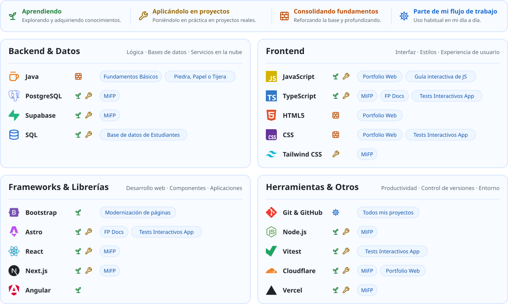

<picture>
  <source media="(prefers-color-scheme: dark)" srcset="./images/top-img-dark.svg">
  <source media="(prefers-color-scheme: light)" srcset="./images/top-img-light.svg">
  
</picture>

## <picture><source media="(prefers-color-scheme: dark)" srcset="./icons/sobre-mi-dark.svg"><source media="(prefers-color-scheme: light)" srcset="./icons/sobre-mi.svg"></picture> Sobre mí

-  Hey 👋🏼, soy Benja. **Técnico en Instalaciones de Telecomunicaciones** y actualmente estudio **Desarrollo de Aplicaciones Web (DAW)**.

-  Mi experiencia trabajando en **tecnología, reparación de dispositivos y atención al cliente** me ha dado una visión práctica de las necesidades de los usuarios y de cómo resolver problemas reales.

-  Mi punto de partida es **Java**, donde estoy construyendo fundamentos sólidos de **programación y POO**.

-  Estoy ampliando mis conocimientos en **desarrollo web, programación y bases de datos**, con la vista puesta en el **desarrollo full-stack**. También estoy explorando **IA aplicada al desarrollo** y el área de **DevOps**, la cual no descarto como futura especialización.

 

<a href="https://benrios.dev"><picture><source media="(prefers-color-scheme: dark)" srcset="./buttons/portfolio-dark.svg"><source media="(prefers-color-scheme: light)" srcset="./buttons/portfolio.svg"></picture></a>&nbsp;&nbsp;&nbsp;<a href="https://www.linkedin.com/in/benriosdev/"><picture><source media="(prefers-color-scheme: dark)" srcset="./buttons/linkedin-dark.svg"><source media="(prefers-color-scheme: light)" srcset="./buttons/linkedin.svg"></picture></a>&nbsp;&nbsp;&nbsp;<a href="https://benrios.dev/#contacto"><picture><source media="(prefers-color-scheme: dark)" srcset="./buttons/email-dark.svg"><source media="(prefers-color-scheme: light)" srcset="./buttons/email.svg"></picture></a>

 

## <picture><source media="(prefers-color-scheme: dark)" srcset="./icons/destacados-dark.svg"><source media="(prefers-color-scheme: light)" srcset="./icons/destacados.svg"></picture> Proyectos Destacados

<table>
<tr>
<td width="50%" valign="top">

### <picture><source media="(prefers-color-scheme: dark)" srcset="./icons/mifp-dark.svg"><source media="(prefers-color-scheme: light)" srcset="./icons/mifp.svg"></picture> MiFP

Compañero de estudios para alumnos de FP Online: gestión de PACs, videotutorías, notas y recursos con dashboard en tiempo real. Proyecto en colaboración.

`React` `Next.js` `TypeScript` `Tailwind CSS` `Supabase`

<a href="https://github.com/ProyectoBS-Dev/mifp-web">
<picture>
  <source media="(prefers-color-scheme: dark)" srcset="./buttons/repositorio-dark.svg">
  <source media="(prefers-color-scheme: light)" srcset="./buttons/repositorio.svg">
  
</picture>
</a>

</td>

<td width="50%" valign="top">

### <picture><source media="(prefers-color-scheme: dark)" srcset="./icons/tests-dark.svg"><source media="(prefers-color-scheme: light)" srcset="./icons/tests.svg"></picture> Tests Interactivos App

Ante la falta de material didáctico actualizado para estudiantes de FP, creé una app web interactiva de tests de exámenes, facilitando el estudio y la autoevaluación.

`Astro` `TypeScript` `CSS` `Vitest`

<a href="https://github.com/benriosdev/tests-interactivos">
<picture>
  <source media="(prefers-color-scheme: dark)" srcset="./buttons/repositorio-dark.svg">
  <source media="(prefers-color-scheme: light)" srcset="./buttons/repositorio.svg">
  
</picture>
</a>

</td>
</tr>

<tr>
<td width="50%" valign="top">

### <picture><source media="(prefers-color-scheme: dark)" srcset="./icons/portafolio-dark.svg"><source media="(prefers-color-scheme: light)" srcset="./icons/portafolio.svg"></picture> Portafolio Web

Portafolio personal donde muestro mi experiencia, proyectos y perfil Front-End + UI/UX.

`HTML` `CSS` `JavaScript` `Responsive Design`

<a href="https://benrios.dev">
<picture>
  <source media="(prefers-color-scheme: dark)" srcset="./buttons/visitar-dark.svg">
  <source media="(prefers-color-scheme: light)" srcset="./buttons/visitar.svg">
  
</picture>
</a>

</td>

<td width="50%" valign="top">

### <picture><source media="(prefers-color-scheme: dark)" srcset="./icons/dax-dark.svg"><source media="(prefers-color-scheme: light)" srcset="./icons/dax.svg"></picture> DAX Repaso

Repaso para DAM y DAW: resúmenes por asignatura, glosario con flashcards, chuletas de referencia rápida y guías de herramientas de desarrollo.

`HTML` `CSS` `JavaScript` `Bootstrap` `Bootstrap Icons`

<a href="https://github.com/benriosdev/dax-repaso">
<picture>
  <source media="(prefers-color-scheme: dark)" srcset="./buttons/repositorio-dark.svg">
  <source media="(prefers-color-scheme: light)" srcset="./buttons/repositorio.svg">
  
</picture>
</a>

</td>
</tr>
</table>

 

## <picture><source media="(prefers-color-scheme: dark)" srcset="./icons/aprendizaje-dark.svg"><source media="(prefers-color-scheme: light)" srcset="./icons/aprendizaje.svg"></picture> Proyectos de Aprendizaje

| Proyecto | Descripción | Tech | Acceso |
|:---|:---|:---|:---:|
| **Aprendiendo Git y GitHub** | Guía completa de control de versiones, repos y colaboración. | `Git` `GitHub` | <a href="https://benrios.dev/hola-git/git/"><picture><source media="(prefers-color-scheme: dark)" srcset="./buttons/guia-dark.svg"><source media="(prefers-color-scheme: light)" srcset="./buttons/guia.svg"></picture></a> |
| **Base de datos de Estudiantes** | Proyecto de BD relacional: diseño de tablas, relaciones y modelo E-R. | `SQL` | <a href="https://benrios.dev/modelo-er/"><picture><source media="(prefers-color-scheme: dark)" srcset="./buttons/modelo-dark.svg"><source media="(prefers-color-scheme: light)" srcset="./buttons/modelo.svg"></picture></a> |
| **Java Fundamentos Básicos** | App educativa para aprender Java desde cero con ejercicios interactivos. | `Java` | <a href="https://benrios.dev/fundamentos-java/"><picture><source media="(prefers-color-scheme: dark)" srcset="./buttons/proyecto-dark.svg"><source media="(prefers-color-scheme: light)" srcset="./buttons/proyecto.svg"></picture></a> |
| **Guía interactiva de JavaScript** | Guía de fundamentos de JS, desde variables hasta el DOM y eventos. | `JavaScript` `HTML` `CSS` | <a href="https://benrios.dev/javascript/"><picture><source media="(prefers-color-scheme: dark)" srcset="./buttons/aprender-dark.svg"><source media="(prefers-color-scheme: light)" srcset="./buttons/aprender.svg"></picture></a> |
| **Piedra, Papel o Tijera** | PAC de desarrollo de DAW. Juego clásico en Java con lógica de partida y puntuación. | `Java` | <a href="https://benrios.dev/piedra-papel-tijera-java/"><picture><source media="(prefers-color-scheme: dark)" srcset="./buttons/jugar-dark.svg"><source media="(prefers-color-scheme: light)" srcset="./buttons/jugar.svg"></picture></a> |

 

## <picture><source media="(prefers-color-scheme: dark)" srcset="./icons/tecnologias-dark.svg"><source media="(prefers-color-scheme: light)" srcset="./icons/tecnologias.svg"></picture> Mis Tecnologías / Stack

<picture>
  <source media="(prefers-color-scheme: dark)" srcset="./images/tech-stack-dark.svg">
  <source media="(prefers-color-scheme: light)" srcset="./images/tech-stack-light.svg">
  
</picture>

## <picture><source media="(prefers-color-scheme: dark)" srcset="./icons/ia-dark.svg"><source media="(prefers-color-scheme: light)" srcset="./icons/ia.svg"></picture> IA & herramientas de desarrollo

-  **Antigravity**: mi IDE principal, donde desarrollo mis proyectos.
-  **IntelliJ IDEA**: para Java, practicar POO y mis proyectos en Java.
-  **VS Code**: para ediciones rápidas y revisar código.
-  **Claude Code**: mi asistente en la terminal para programar y revisar proyectos sobre el repositorio.
-  **ChatGPT**: para aprender, resolver dudas y planificar proyectos.
-  **Gemini Pro**: una segunda opinión para contrastar información y soluciones.

 

## <picture><source media="(prefers-color-scheme: dark)" srcset="./icons/estadisticas-dark.svg"><source media="(prefers-color-scheme: light)" srcset="./icons/estadisticas.svg"></picture> GitHub Analytics

<picture>
  <source media="(prefers-color-scheme: dark)" srcset="https://github-readme-streak-stats.herokuapp.com/?user=benriosdev&locale=es&background=0F1626&border=1E3A5F&stroke=1E3A5F&ring=38A8FF&fire=38A8FF&currStreakNum=E6EDF3&sideNums=E6EDF3&currStreakLabel=38A8FF&sideLabels=8B949E&dates=8B949E">
  <source media="(prefers-color-scheme: light)" srcset="https://github-readme-streak-stats.herokuapp.com/?user=benriosdev&locale=es&background=F8FBFF&border=CFE2FF&stroke=CFE2FF&ring=1769D1&fire=1769D1&currStreakNum=1F2328&sideNums=1F2328&currStreakLabel=1769D1&sideLabels=59636E&dates=59636E">
  
</picture>

 

### **¡Gracias por visitar mi perfil y acompañarme mientras sigo aprendiendo y construyendo!**
 

